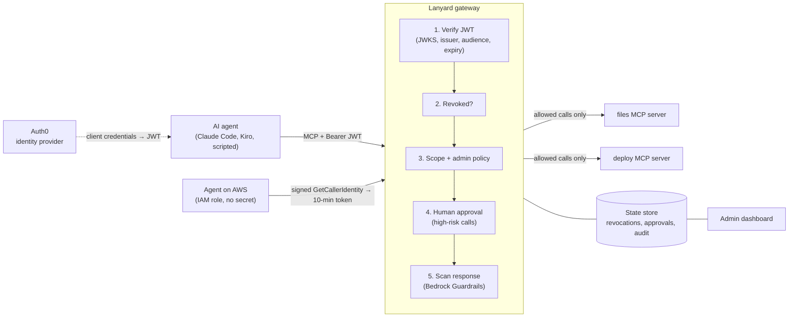
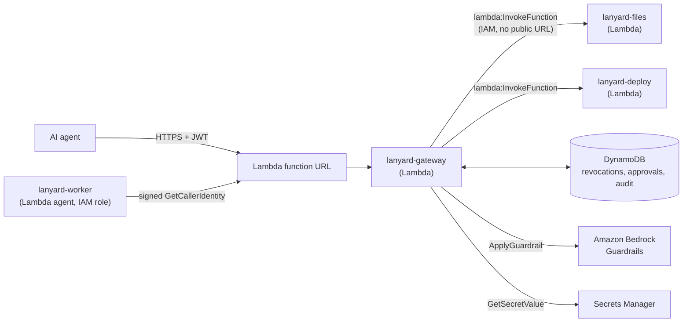

# Lanyard

**Identity and access control for AI agents, with revocation that takes effect on the next call.**

AI agents now call tools on their own: they read files, change records and deploy code. Most setups give an agent a tool and hope for the best. If the agent misbehaves halfway through a task, its access token stays valid until it expires, often for hours.

Lanyard is a gateway between AI agents and their [MCP](https://modelcontextprotocol.io) tools. Every agent gets an enterprise identity, sees only the tools its permissions allow, and has every call checked, scanned and logged. An admin can take an agent's access away mid-task, and its very next call is refused, even though its token has not expired.

## What it does

| | |
|---|---|
| **Agent identity** | Each agent authenticates with OAuth 2.0 client credentials against Auth0 (Okta) and presents a signed JWT on every request. |
| **Workload identity** | Agents running on AWS sign in with their IAM role and hold no secret at all. The agent signs an `sts:GetCallerIdentity` request bound to Lanyard; Lanyard has AWS verify it, maps the role to an agent identity, and issues a 10-minute token. |
| **Least privilege** | Token scopes map to tools. `tools/list` only returns the tools an agent may call, and `tools/call` is enforced again server side. Unknown tools are denied by default. |
| **Instant revocation** | Revocation is keyed on the agent's identity (Auth0 client ID or IAM role), not the token, and is checked on every request. A revoked agent gets HTTP 403 on its next call, and fetching a new token does not help. |
| **Cut off at the source** | Revoking also removes the agent's grant in Auth0 (through the Management API), so Auth0 stops issuing it tokens; Restore recreates the grant. Revoked workload identities are refused new Lanyard tokens. |
| **Sub-agents with cascade revoke** | An agent can create a helper with a subset of its own permissions (never more). The helper's token records its chain of parents, so revoking any agent in the chain cuts off everything below it. |
| **Tainted agents** | When an agent reads content flagged as prompt injection, Lanyard marks it tainted: its risky calls (writes, deploys) need human approval until an admin clears it. |
| **Per-tool admin control** | An admin can block a single tool for a single agent from the dashboard, narrowing access below what the token allows. |
| **Human approval** | High-risk calls, such as production deploys, are held until a person approves or denies them on the dashboard. |
| **Tool-response guardrails** | Tool output is scanned with Amazon Bedrock Guardrails before the agent's model sees it. Prompt injection hidden in data, such as a poisoned file, is blocked; emails and phone numbers are masked. |
| **Admin console** | Live overview with decision charts, per-agent identity and tool access, sub-agent trees, an approval queue, a searchable audit log with CSV export, and the active policy. |
| **Attack lab** | Eight real attacks (forged and unsigned tokens, hidden-tool calls, default-deny bypass, sub-agent privilege escalation, prompt injection, revoked-token replay, AWS proof replay) run against the live gateway from the console. All eight are blocked. |
| **Tamper-proof audit trail** | Every decision is logged with the agent, tool, arguments, outcome and reason, and copied through a DynamoDB stream to S3 with Object Lock in compliance mode, so no one can edit or delete it during retention. |
| **Synthetic company + traffic simulator** | A fictional company's file share (invoices, tickets, contracts, reports, two poisoned tickets) lives in S3, and five simulated agents, each with its own IAM role, generate realistic traffic through the real checks. |

## Architecture



The gateway holds no state of its own. Revocations, admin blocks, pending approvals and the audit log all live in the store, so any number of gateway instances enforce the same decisions. The store is SQLite for local development and DynamoDB in the cloud, behind the same interface. Security-relevant reads from DynamoDB are strongly consistent: a revocation written through one instance blocks the agent's next call on every other instance.

## Security decisions

- **Revoke the identity, not the token.** JWTs cannot be recalled, and an agent with client credentials can always mint a new one. Lanyard keys revocation on the `azp` (client ID) claim and checks it on every request, and also removes the agent's grant at Auth0 so no new token can be minted.
- **No secrets for workloads.** An agent on AWS proves its identity with a SigV4 signature from its IAM role. The signed request must carry Lanyard's audience header inside the signature, so it cannot be replayed against another service, and Lanyard only accepts roles in its own AWS account. Lanyard never sees the agent's AWS credentials.
- **Two issuers, each pinned.** Auth0 tokens are verified only with RS256 and Auth0's public keys; Lanyard's own workload tokens only with HS256 and a key held in AWS Secrets Manager. A token cannot switch algorithm or issuer to slip through.
- **Default deny.** A tool with no policy entry is not callable, even by a fully scoped agent.
- **Enforce twice.** Hiding a tool from `tools/list` is a convenience; `tools/call` is authorized independently, so a client that guesses tool names gains nothing.
- **Fail closed.** If the guardrail scan is unavailable, tool responses are withheld rather than passed through unchecked.
- **Readable denials.** A denied call returns a tool error the agent's model can understand ("requires scope deploy:run"), so the agent reports the denial instead of retrying.
- **Known limit:** revocation stops the next call. A call that was already forwarded to a tool server before the revocation completes.

## Running it

Requirements: Python 3.11+, [uv](https://docs.astral.sh/uv/), an Auth0 tenant (free plan works), and optionally AWS credentials with Amazon Bedrock access.

**1. Auth0 setup**
- Create an API with identifier `https://lanyard-api` and permissions `files:read`, `files:write`, `deploy:run`.
- Create two Machine-to-Machine applications authorized for that API: `trusted-agent` with all three permissions, and `intern-agent` with `files:read` only.

**2. Configuration:** copy `.env.example` to `.env` and fill in the values.

**3. Optional guardrail:** create a Bedrock guardrail with the `PROMPT_ATTACK` content filter (input) and `EMAIL`/`PHONE` PII anonymization (input), and put its ID in `.env`. Without it, Lanyard runs with the scan disabled.

**4. Start everything**
```bash
uv sync
scripts/start.sh          # tool servers + gateway; dashboard at http://127.0.0.1:8000
```

**5. Run an agent through Lanyard**
```bash
uv run python scripts/demo_agent.py trusted      # scripted agent, predictable for demos
uv run python scripts/demo_agent.py intern
uv run python scripts/demo_agent.py aws          # sign in with this machine's AWS identity
scripts/launch_agent.sh trusted                  # Claude Code as a governed agent
scripts/run_cloud_agent.sh                       # an agent inside AWS Lambda, no stored secret
uv run python scripts/demo_agent.py team         # sub-agents; revoke trusted-agent to cut off all of them
scripts/simulator.sh on|off                      # cloud traffic simulator (5 synthetic agents)
uv run python scripts/generate_data.py --upload  # regenerate the synthetic file share
scripts/reset_demo.sh                            # clear state between demos
```

Any of these work against the cloud deployment by setting `LANYARD_URL` to its URL.

## Project layout

```
lanyard/gateway.py      MCP endpoint, authorization pipeline, admin API
lanyard/policy.py       backends, tool → scope map, approval rules, workload identities
lanyard/workload.py     AWS IAM workload identity (sign, verify, issue tokens)
lanyard/auth0_admin.py  remove and restore an agent's Auth0 grant
lanyard/guardrails.py   Bedrock Guardrails scan of tool responses
lanyard/agent_runner.py scripted agent and sub-agent team, used on a laptop and in the cloud
lanyard/simulator.py    synthetic agents with their own IAM roles
lanyard/attacks.py      attack lab
lanyard/archiver.py     DynamoDB stream -> S3 Object Lock audit archive
lanyard/store.py        state store (SQLite)
lanyard/dynamo_store.py state store (DynamoDB)
lanyard/dashboard.html  admin dashboard
lanyard/lambda_handler.py   gateway entry point on AWS Lambda
servers/                mock MCP tool servers (files, deploy), their Lambda entry point, sample data
scripts/                start, reset, deploy, token helper, scripted and Claude Code agents
```

## On AWS



| Service | Role in Lanyard |
|---|---|
| **AWS Lambda** | Runs the gateway and both tool servers. Lambda scales the gateway out on demand; because it is stateless, every copy enforces the same decisions. |
| **Lambda function URL** | The gateway's public HTTPS endpoint. Agents authenticate with their JWT; the dashboard and admin API require a password. |
| **Amazon DynamoDB** | Shared state: revocations, admin tool blocks, pending approvals, and the audit log. Strongly consistent reads make revocation immediate across instances. |
| **Amazon Bedrock Guardrails** | Scans every tool response for prompt injection and masks emails and phone numbers. |
| **AWS IAM** | The gateway's role can only read and write its table, read its secret, invoke the two tool functions, and apply the guardrail. The tool functions have no public URL, so tools cannot be reached without going through Lanyard. The worker agent's role has no permissions at all: its identity is all it needs. |
| **AWS STS** | Verifies workload identity: Lanyard forwards the agent's signed `GetCallerIdentity` request, and AWS confirms which role signed it. |
| **Amazon S3** | The company file share (private, encrypted) and the audit archive (Object Lock, compliance mode). |
| **DynamoDB Streams** | Feed every new audit event to the archiver Lambda. |
| **Amazon EventBridge** | Starts the traffic simulator every minute when it is switched on. |
| **AWS Secrets Manager** | Holds the gateway's secrets: the workload token signing key, the admin password, and the optional Auth0 management credential. |

Agents' Auth0 client secrets are never deployed; the gateway verifies their tokens with Auth0's public keys.

**Deploy:** `scripts/build_lambda.sh && uv run python scripts/deploy_aws.py`. This creates or updates the roles and functions, prints the dashboard URL, and saves the URL and a generated admin password to `.env`. It expects a DynamoDB table named `lanyard` with string keys `pk` (partition) and `sk` (sort).

Amazon Bedrock AgentCore Gateway and AgentCore Identity offer a managed version of the identity layer; Lanyard's policy engine, approval flow and response scanning are designed to sit alongside them.

## Roadmap

- Delegated access: an agent acting for a signed-in user gets the intersection of both sets of permissions (OAuth token exchange)
- Rate limits and automatic revocation when an agent's denial rate spikes
