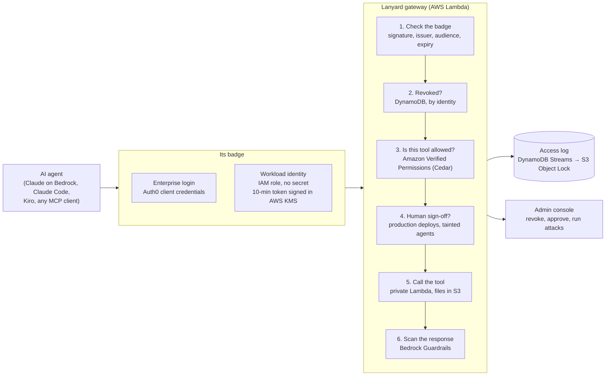
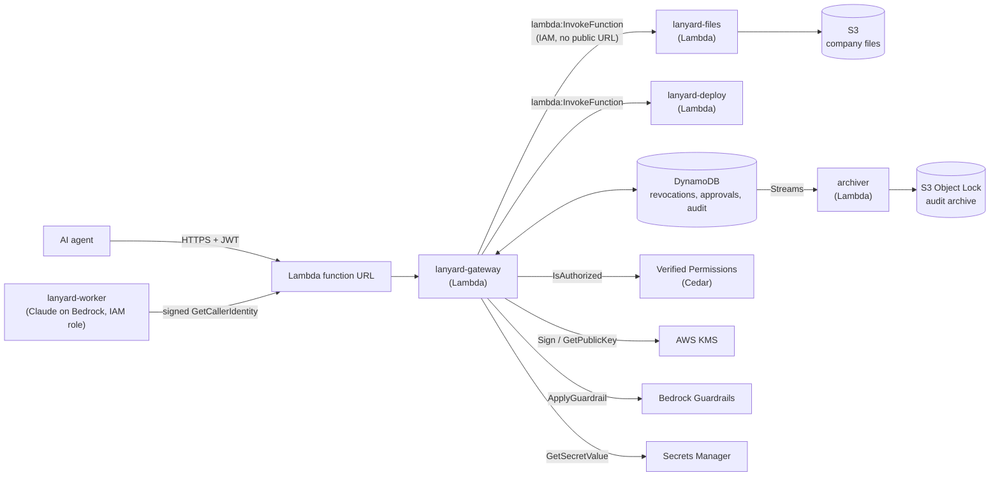

# Lanyard

**Identity and access control for AI agents, with revocation that takes effect on the very next call.**


Lanyard is a gateway that sits between AI agents and the tools they use. Every agent gets an identity (a badge), sees only the tools it is allowed to use, and has every single call checked, scanned and logged. An admin can take an agent's badge away mid-task, and its next call is refused, even though its token has not expired.

Built for the A10 Agentic Identity track. Running live on AWS.

## Demo

<!-- DEMO VIDEO: replace this comment with the github.com/user-attachments/assets/... link on its own line -->

*A 6-minute walkthrough: how a tool call flows through Lanyard, revoking an agent mid-task, a real Claude agent meeting a prompt injection, and nine live attacks against the gateway.*


## The problem

AI agents don't just chat anymore. They read customer data, change records and deploy code, by calling tools on their own. Most setups hand an agent a token and hope for the best.

That token is the weak point. If an agent goes wrong halfway through a task (a bug, a bad prompt, a poisoned document), its token stays valid until it expires, often for hours. There is no way to recall it, and nothing checks what the agent does with it call by call.

## What Lanyard does

- **Every agent has an identity.** Enterprise agents log in through Auth0 (Okta). Agents running on AWS prove who they are with their IAM role and hold no secret at all.
- **Every tool call is checked.** Not once at login: on every call, against Cedar policies in Amazon Verified Permissions.
- **Revocation is instant.** Lanyard revokes the *identity*, not the token, and checks it first on every call. The revoked agent's next call gets HTTP 403, and Auth0 stops issuing it new tokens.
- **What comes back is scanned.** Tool output passes through Amazon Bedrock Guardrails before the agent's model reads it. An agent that reads a prompt injection is marked tainted, and its risky calls wait for a human.
- **Everything is on the record.** Every decision, with its reason, goes to an audit archive in S3 with Object Lock that no one can edit or delete.

## One tool call, end to end



| Step | What happens | AWS service |
|---|---|---|
| **1. Check the badge** | Signature, issuer, audience and expiry. Forged, unsigned and algorithm-confused tokens fail here. | AWS KMS public key, Auth0 keys |
| **2. Is the badge revoked?** | Checked first, on every call, by identity rather than token. If a parent agent is revoked, its sub-agents are too. | Amazon DynamoDB |
| **3. Is this tool allowed?** | Cedar policies decide: scopes, admin blocks, sub-agent limits, production rules. If AWS can't answer, the call is denied. | Amazon Verified Permissions |
| **4. Does a human need to sign off?** | Production deploys, and risky calls from a tainted agent, wait at the Security desk. | Amazon DynamoDB |
| **5. Call the tool** | Tool servers are private Lambda functions with no public URL. Files live in S3. | AWS Lambda, Amazon S3 |
| **6. Scan what comes back** | Prompt injection is blocked before the AI reads it, and the agent is tainted. Emails and phone numbers are masked. | Amazon Bedrock Guardrails |


## Features

| | |
|---|---|
| **Agent identity** | Each agent authenticates with OAuth 2.0 client credentials against Auth0 (Okta) and presents a signed JWT on every request. |
| **Workload identity** | Agents on AWS sign in with their IAM role and hold no secret. The agent signs an `sts:GetCallerIdentity` request bound to Lanyard; Lanyard has AWS verify it, maps the role to an agent identity, and issues a 10-minute token signed by AWS KMS. |
| **Policy as code** | Every tool call is decided by Cedar policies in Amazon Verified Permissions: a permit for "the token has the tool's scope", forbids for admin blocks and for sub-agents touching production, and approval gates for production deploys and tainted agents. |
| **A real AI agent** | Claude Opus 5.5 on Amazon Bedrock runs as a Lambda, signs in with its own IAM role, and decides which tools to call. Lanyard governs every call: it reads a poisoned ticket, is blocked and tainted, and its next write waits for a human. |
| **Least privilege** | Token scopes map to tools. `tools/list` only returns the tools an agent may call, and `tools/call` is enforced again server side. Unknown tools are denied by default. |
| **Instant revocation** | Revocation is keyed on the agent's identity (Auth0 client ID or IAM role) and checked on every request. Fetching a new token does not help. |
| **Cut off at the source** | Revoking also removes the agent's grant in Auth0 through the Management API, so Auth0 stops issuing it tokens. Restore recreates the grant. Revoked workload identities are refused new Lanyard tokens. |
| **Sub-agents with cascade revoke** | An agent can create a helper with a subset of its own permissions, never more. The helper's token records its chain of parents, so revoking any agent in the chain cuts off everything below it. |
| **Tainted agents** | When an agent reads content flagged as prompt injection, it is marked tainted: its risky calls (writes, deploys) need human approval until an admin clears it. |
| **Per-tool admin control** | An admin can block a single tool for a single agent, narrowing access below what the token allows. |
| **Human approval** | High-risk calls, such as production deploys, are held until a person approves or denies them. No answer within two minutes means no. |
| **Tamper-proof audit trail** | Every decision is logged with the agent, tool, arguments, outcome and reason, and copied through a DynamoDB stream to S3 with Object Lock in compliance mode. |
| **Attack lab** | Nine real attacks run against the live gateway from the console. All nine are blocked (see below). |
| **Synthetic company** | A fictional company's file share (invoices, tickets, contracts, reports, and two poisoned tickets) lives in S3, and five simulated agents, each with its own IAM role, generate realistic traffic through the real checks. |

## The console

| | |
|---|---|
|  |  |
| **Agent badges.** Each agent's identity and the tools it may use. Revoke a badge and its next call is refused. | **Security desk.** A tainted AI agent wants to write a file; it waits until a person decides. |

The console also has a live overview with decision charts, a searchable access log with CSV export, and the active Cedar policy.

## Attack lab


| Attack | Why it fails |
|---|---|
| Forged token | Signature doesn't verify against Auth0's or KMS's public key. |
| Unsigned token (`alg: none`) | Only RS256 is accepted. |
| Algorithm confusion | Lanyard's public key, used as an HMAC secret to sign an HS256 token, gets nowhere: Lanyard tokens are RS256 only. |
| Call a hidden tool directly | `tools/call` is authorized on its own, not just hidden from `tools/list`. |
| Call a tool with no policy | Default deny: no Cedar permit, no call. |
| Privilege escalation via sub-agent | A sub-agent can never have scopes its parent lacks. |
| Prompt injection in a support ticket | Bedrock Guardrails blocks the response and the agent is tainted. |
| Keep using a revoked agent's token | Revocation is checked by identity on every call. |
| Replay an AWS sign-in proof | A proof made for another service doesn't carry Lanyard's audience inside the AWS signature. |

## Security decisions

- **Revoke the identity, not the token.** JWTs cannot be recalled, and an agent with client credentials can always mint a new one. Lanyard keys revocation on the `azp` (client ID) claim and checks it on every request, and also removes the agent's grant at Auth0 so no new token can be minted.
- **No secrets for workloads.** An agent on AWS proves its identity with a SigV4 signature from its IAM role. The signed request must carry Lanyard's audience header inside the signature, so it cannot be replayed against another service, and Lanyard only accepts roles in its own AWS account. Lanyard never sees the agent's AWS credentials.
- **Two issuers, each pinned.** Auth0 tokens are verified only with RS256 and Auth0's public keys. Lanyard's own tokens (workloads, sub-agents) are RS256, signed by an AWS KMS key whose private half never leaves KMS; the public key is published at `/.well-known/jwks.json`. HS256 is rejected, which defeats the classic algorithm-confusion attack.
- **Fail closed, everywhere.** If Verified Permissions or Bedrock Guardrails can't answer, the call is denied or the response withheld. Tested by pointing Lanyard at a missing policy store and at an unreachable endpoint: both deny within seconds.
- **Default deny.** A tool with no policy entry is not callable, even by a fully scoped agent.
- **Enforce twice.** Hiding a tool from `tools/list` is a convenience; `tools/call` is authorized independently, so a client that guesses tool names gains nothing.
- **Never ask a human to approve the impossible.** Before holding a call for approval, Lanyard checks with Verified Permissions that approval would actually allow it.
- **Readable denials.** A denied call returns a tool error the agent's model can understand ("requires scope deploy:run"), so the agent reports the denial instead of retrying.
- **Known limit:** revocation stops the next call. A call that was already forwarded to a tool server before the revocation completes.

## On AWS



| Service | Role in Lanyard |
|---|---|
| **AWS Lambda** | Runs the gateway, both tool servers, the archiver and the AI agent. The gateway keeps no state of its own, so Lambda can run as many copies as needed and every copy enforces the same decisions. |
| **Lambda function URL** | The gateway's public HTTPS endpoint. Agents authenticate with their JWT; the console and admin API require a login. |
| **Amazon DynamoDB** | Shared state: revocations, admin tool blocks, pending approvals, and the audit log. Strongly consistent reads make revocation immediate across instances. |
| **Amazon Verified Permissions** | Evaluates Lanyard's Cedar policies on every tool call. |
| **AWS KMS** | Signs Lanyard-issued tokens (RSA 2048, RS256). No signing key exists outside KMS. |
| **AWS IAM + STS** | Workload identity: Lanyard forwards the agent's signed `GetCallerIdentity` request, and AWS confirms which role signed it. The gateway's own role is scoped to exactly what it needs; the tool functions have no public URL, so tools can't be reached without going through Lanyard. |
| **Amazon Bedrock (Claude Opus 5.5)** | The AI agent's model, through the Anthropic SDK's Bedrock client, with a refusal fallback to Claude Opus 4.8. |
| **Amazon Bedrock Guardrails** | Scans every tool response for prompt injection and masks emails and phone numbers. |
| **Amazon S3** | The company file share (private, encrypted) and the audit archive (Object Lock, compliance mode). |
| **DynamoDB Streams** | Feed every new audit event to the archiver Lambda. |
| **Amazon EventBridge** | Starts the traffic simulator every minute when it is switched on. |
| **AWS Secrets Manager** | Holds the gateway's only secrets: the admin password and the optional Auth0 management credential. |

Agents' Auth0 client secrets are never deployed; the gateway verifies their tokens with Auth0's public keys.

**Deploy:** `scripts/build_lambda.sh && uv run python scripts/deploy_aws.py`. This creates or updates the roles and functions, prints the console URL, and saves the URL and a generated admin password to `.env`. It expects a DynamoDB table named `lanyard` with string keys `pk` (partition) and `sk` (sort).

Amazon Bedrock AgentCore Gateway and AgentCore Identity offer a managed version of the identity layer; Lanyard's policy engine, approval flow and response scanning are designed to sit alongside them.

## Running it locally

Requirements: Python 3.11+, [uv](https://docs.astral.sh/uv/), an Auth0 tenant (the free plan works), and optionally AWS credentials with Amazon Bedrock access.

**1. Auth0 setup**
- Create an API with identifier `https://lanyard-api` and permissions `files:read`, `files:write`, `deploy:run`.
- Create two Machine-to-Machine applications authorized for that API: `trusted-agent` with all three permissions, and `intern-agent` with `files:read` only.

**2. Configuration:** copy `.env.example` to `.env` and fill in the values.

**3. Optional guardrail:** create a Bedrock guardrail with the `PROMPT_ATTACK` content filter (input) and `EMAIL`/`PHONE` PII anonymization (input), and put its ID in `.env`. Without it, Lanyard runs with the scan disabled.

**4. Start everything**
```bash
uv sync
scripts/start.sh          # tool servers + gateway; console at http://127.0.0.1:8000
```

The local version stores state in SQLite instead of DynamoDB, behind the same interface.

**5. Run an agent through Lanyard**
```bash
uv run python scripts/demo_agent.py trusted      # scripted agent, predictable for demos
uv run python scripts/demo_agent.py intern
uv run python scripts/demo_agent.py aws          # sign in with this machine's AWS identity
scripts/launch_agent.sh trusted                  # Claude Code as a governed agent
scripts/run_cloud_agent.sh                       # an agent inside AWS Lambda, no stored secret
scripts/run_ai_agent.sh                          # Claude Opus 5.5 on Bedrock, governed by Lanyard
uv run python -m lanyard.ai_agent                # the same AI agent from your laptop
uv run python scripts/demo_agent.py team         # sub-agents; revoke trusted-agent to cut off all of them
scripts/simulator.sh on|off                      # cloud traffic simulator (5 synthetic agents)
uv run python scripts/generate_data.py --upload  # regenerate the synthetic file share
scripts/reset_demo.sh                            # clear state between demos
```

Any of these work against the cloud deployment by setting `LANYARD_URL` to its URL.

## Project layout

```
lanyard/gateway.py        MCP endpoint, authorization pipeline, admin API
lanyard/policy.py         backends, tool → scope map, approval rules, workload identities
lanyard/avp.py            Amazon Verified Permissions: Cedar policies and the authorization call
lanyard/tokens.py         KMS (RS256) signing and verification of Lanyard tokens, public JWKS
lanyard/workload.py       AWS IAM workload identity (sign, verify, issue tokens)
lanyard/auth0_admin.py    remove and restore an agent's Auth0 grant
lanyard/guardrails.py     Bedrock Guardrails scan of tool responses
lanyard/ai_agent.py       Claude Opus 5.5 on Bedrock as a governed agent
lanyard/agent_runner.py   scripted agent and sub-agent team, used on a laptop and in the cloud
lanyard/simulator.py      synthetic agents with their own IAM roles
lanyard/attacks.py        attack lab
lanyard/archiver.py       DynamoDB stream → S3 Object Lock audit archive
lanyard/store.py          state store (SQLite)
lanyard/dynamo_store.py   state store (DynamoDB)
lanyard/dashboard.html    admin console
lanyard/lambda_handler.py gateway entry point on AWS Lambda
servers/                  MCP tool servers (files, deploy), their Lambda entry point, sample data
scripts/                  start, reset, deploy, token helper, scripted and Claude Code agents
docs/                     demo script, video script, screenshots
```

## Roadmap

- Delegated access: an agent acting for a signed-in user gets the intersection of both sets of permissions (OAuth token exchange)
- Rate limits and automatic revocation when an agent's denial rate spikes
