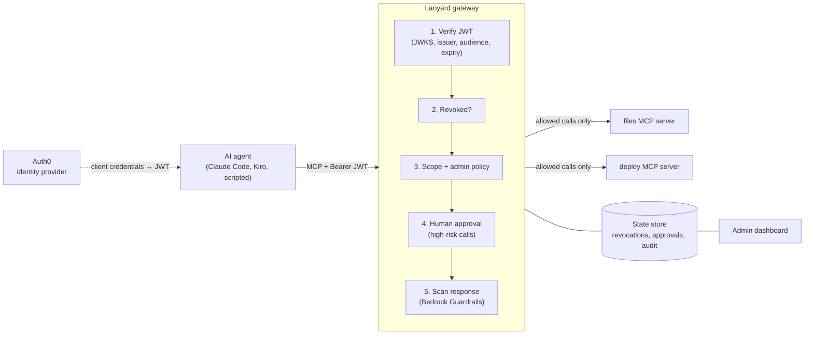

# Lanyard

**Identity and access control for AI agents, with revocation that takes effect on the next call.**

AI agents now call tools on their own: they read files, change records and deploy code. Most setups give an agent a tool and hope for the best. If the agent misbehaves halfway through a task, its access token stays valid until it expires, often for hours.

Lanyard is a gateway between AI agents and their [MCP](https://modelcontextprotocol.io) tools. Every agent gets an enterprise identity, sees only the tools its permissions allow, and has every call checked, scanned and logged. An admin can take an agent's access away mid-task, and its very next call is refused, even though its token has not expired.

## What it does

| | |
|---|---|
| **Agent identity** | Each agent authenticates with OAuth 2.0 client credentials against Auth0 (Okta) and presents a signed JWT on every request. |
| **Least privilege** | Token scopes map to tools. `tools/list` only returns the tools an agent may call, and `tools/call` is enforced again server side. Unknown tools are denied by default. |
| **Instant revocation** | Revocation is keyed on the agent's identity (`client_id`), not the token, and is checked on every request. A revoked agent gets HTTP 403 on its next call, and fetching a new token does not help. |
| **Per-tool admin control** | An admin can block a single tool for a single agent from the dashboard, narrowing access below what the token allows. |
| **Human approval** | High-risk calls, such as production deploys, are held until a person approves or denies them on the dashboard. |
| **Tool-response guardrails** | Tool output is scanned with Amazon Bedrock Guardrails before the agent's model sees it. Prompt injection hidden in data, such as a poisoned file, is blocked; emails and phone numbers are masked. |
| **Audit trail** | Every decision is logged with the agent, tool, arguments, outcome and reason, and streamed to a live dashboard. |

## Architecture



The gateway holds no state of its own. Revocations, admin blocks, pending approvals and the audit log all live in the store, so several gateway instances can enforce the same decisions. The store is SQLite locally; DynamoDB is the production target behind the same interface.

## Security decisions

- **Revoke the identity, not the token.** JWTs cannot be recalled, and an agent with client credentials can always mint a new one. Lanyard keys revocation on the `azp` (client ID) claim and checks it on every request.
- **Default deny.** A tool with no policy entry is not callable, even by a fully scoped agent.
- **Enforce twice.** Hiding a tool from `tools/list` is a convenience; `tools/call` is authorized independently, so a client that guesses tool names gains nothing.
- **Fail closed.** If the guardrail scan is unavailable, tool responses are withheld rather than passed through unchecked.
- **Readable denials.** A denied call returns a tool error the agent's model can understand ("requires scope deploy:run"), so the agent reports the denial instead of retrying.
- **Known limit:** revocation stops the next call. A call that was already forwarded to a tool server before the revocation completes.

## Running it

Requirements: Python 3.11+, [uv](https://docs.astral.sh/uv/), an Auth0 tenant (free plan works), and optionally AWS credentials with Amazon Bedrock access.

**1. Auth0 setup**
- Create an API with identifier `https://lanyard-api` and permissions `files:read`, `files:write`, `deploy:run`.
- Create two Machine-to-Machine applications authorized for that API: `trusted-agent` with all three permissions, and `intern-agent` with `files:read` only.

**2. Configuration:** copy `.env.example` to `.env` and fill in the values.

**3. Optional guardrail:** create a Bedrock guardrail with the `PROMPT_ATTACK` content filter (input) and `EMAIL`/`PHONE` PII anonymization (input), and put its ID in `.env`. Without it, Lanyard runs with the scan disabled.

**4. Start everything**
```bash
uv sync
scripts/start.sh          # tool servers + gateway; dashboard at http://127.0.0.1:8000
```

**5. Run an agent through Lanyard**
```bash
uv run python scripts/demo_agent.py trusted      # scripted agent, predictable for demos
uv run python scripts/demo_agent.py intern
scripts/launch_agent.sh trusted                  # Claude Code as a governed agent
scripts/reset_demo.sh                            # clear state between demos
```

## Project layout

```
lanyard/gateway.py      MCP endpoint, authorization pipeline, admin API
lanyard/policy.py       backends, tool → scope map, approval rules
lanyard/guardrails.py   Bedrock Guardrails scan of tool responses
lanyard/store.py        state store (SQLite)
lanyard/dashboard.html  admin dashboard
servers/                mock MCP tool servers (files, deploy) and sample data
scripts/                start, reset, token helper, scripted and Claude Code agents
```

## On AWS

Lanyard uses Amazon Bedrock Guardrails today. The production path is the gateway on AWS App Runner or ECS behind a load balancer, with revocations, approvals and the audit log in DynamoDB so that every instance enforces a revocation immediately. Amazon Bedrock AgentCore Gateway and AgentCore Identity offer a managed version of the identity layer; Lanyard's policy engine, approval flow and response scanning are designed to sit alongside them.

## Roadmap

- DynamoDB store and multi-instance deployment
- Revoking the agent's grant in Auth0 as well, so no new tokens are issued
- Delegated access: an agent acting for a signed-in user gets the intersection of both sets of permissions (OAuth token exchange)
- Rate limits and automatic revocation when an agent's denial rate spikes
